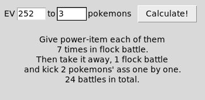

EffortLevelingSupport
===

ポケモンの努力値振りを手伝う、 tkinter 製の GUI ツールだよ。

- Docker: 対応!
- Python: 3.15!
- Linter: Ruff 0.17!
- Test: pytest 9.1!
- パッケージ管理: uv 0.13!
- GUI: tkinter (Tk 8.6)! Docker ではブラウザ (noVNC 1.7) から操作できる

## パッと実行してみたい

```bash
docker compose up --build
```

- ブラウザで `http://localhost:6080/vnc.html?autoconnect=true` を開くと、そのまま使える
- `EV` に振りたい努力値、 `to` に同時に育てるポケモン数を入れて `Calculate!` (または Enter キー) を押すと、下に結果が出る
    - 例: `252` と `3` → `Give power-item each of them 7 times in flock battle. Then take it away, 1 flock battle and kick 2 pokemons' ass one by one. 24 battles in total.`
    - 0 回の手順は省略。たとえば `24` と `6` → `Without power-item, 4 flock battles and kick 4 pokemons' ass one by one. 8 battles in total.`
    - 努力値は 1〜252、ポケモン数は 1〜6。全角数字も OK。範囲外や数字以外 (`abc`、 `2.5`、 `+3`、 `2_52` など) はエラーメッセージになる
- 止めるときは `Ctrl+C`。別ターミナルなら `docker compose down`
- 公開先はホストの `127.0.0.1:6080` だけ。 VNC にパスワードはないので、同じ PC のほかのユーザからも操作できる。ほかのマシンには公開しないでね
- 6080 が使用中なら `ELS_PORT=16080 docker compose up --build` のようにポートを変えられる

lint とテストもコンテナの中で回せる。

```bash
docker compose run --rm app ruff check .
docker compose run --rm app ruff format --check .
docker compose run --rm app xvfb-run -a pytest
```

- `ruff` はエラーがなければ `All checks passed!` などを出して終了コード 0 で終わる
- `pytest` は仮想ディスプレイ (Xvfb) 上で GUI のテストまで実行する
- GitHub Actions (`.github/workflows/ci.yml`) でも、 `master` への push と pull request ごとに同じ 3 コマンドを回す。さらに `docker compose up --wait` で、 noVNC と VNC サーバーの応答まで確認する構成だよ。デプロイや公開はしない

Docker なしなら、 Tk 付きの Python 3.15 と [uv](https://docs.astral.sh/uv/) を用意してね。

```bash
uv run python effort_leveling_support.py
uv sync && uv run ruff check . && uv run pytest
```

- GUI テストにはディスプレイが必要。画面のない Linux なら `xvfb-run -a uv run pytest` で仮想ディスプレイを使おう

## どんなツール?



初代の画面はこちら。


以下の条件のときが対象。

- n体 (6体まで) のポケモンにeずつ努力値を振りたい
- ただしパワー系アイテムが一個しかない

こんな手順を教えてくれるよ。

- 「パワーアイテムを各ポケモンに順番に持たせそれぞれ群れバトルx戦せよ」
- 「その後、パワーアイテムを外して群れバトルz戦、一体戦をy戦せよ」

全員に同じ回数ずつパワーアイテムを持たせ、残りを道具なしの群れバトルと一体戦で揃える。
その手順の中から、全員の努力値がちょうど e になり、合計戦闘数が最小になるものを出す。
持たせる回数を人ごとに変えたり、持たせたまま一体戦をしたりしても、これより少ない戦闘数にはならないこともテストで確かめている。

第6世代 (XY / ORAS) の仕様が前提だよ。

- 群れバトルは相手が5体で、1体あたり努力値1
- パワー系アイテムは1体あたり +4 → 持たせたポケモンは群れバトル1戦で 25
- 学習装置で、持たせていないポケモンも群れバトル1戦で 5
- 一体戦は1戦で 1
- 1つの能力に振れる努力値は 252 まで、学習装置が効く手持ちは 6 体まで
